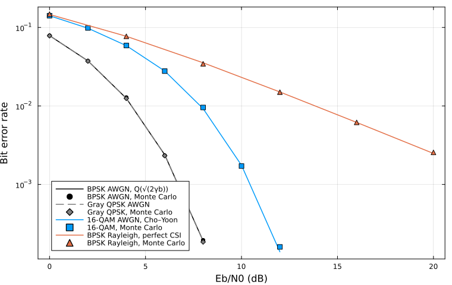

[中文](README.md) | **English**

# CommToolkit.jl

A baseband communications link simulator, currently **v1.2.2** ([`Project.toml`](Project.toml)). It matches Monte Carlo error rates to textbook closed-form formulas, and runs a teaching-level MCS / HARQ loop on AWGN. Author: 刘恒宇 (longee142857).

Names brought in by `using CommToolkit` are the stable surface, frozen under SemVer: removing a name, renaming it, or changing the meaning of a positional argument or an existing return value bumps the major version. Relative to 1.0.0, 1.x only adds. Per-release detail is in the [changelog](CHANGELOG.md).

## Install

Julia 1.10 or newer. `using CommToolkit` does not load Plots; run `using Plots` when you want figures.

```julia
using Pkg
Pkg.add(url="https://github.com/longee142857/CommToolkit.jl")
using CommToolkit
```

## Quick start

```julia
bits = rand(0:1, 10_000)
rx = awgn(modulate(bits, BPSK()), 8, 1)  # 8 dB Eb/N0
ber(bits, demodulate(rx, BPSK()))
```

`8` is ``E_b/N_0`` in dB for this BPSK call. The argument of `simulate_link` is ``E_s/N_0``, and `apply_channel` is a time-domain sample SNR. `noise_var` in the soft demodulator is the per-real-dimension ``\sigma^2 = N_0/2``. The value returned by a complex `fir_channel`, and `noise_var` of `apply_mimo`, are the total complex noise power ``N_0``. Each function's docstring names its own quantity.

## Features

The public API is re-exported flat from the submodules, for example `modulate(bits, BPSK())`. There are no deprecation aliases.

- **Modulation**: BPSK, Gray QPSK / M-PSK / square M-QAM; hard decisions and per-bit LLRs on coherent AWGN. DBPSK / DQPSK place a reference symbol at the start of the block.
- **Channel**: AWGN (`snr_db` is ``E_b/N_0``), flat Rayleigh and block fading, Rice, Clarke/Jakes, Nakagami-m, MRC with ideal CSI, FIR with given taps, and a teaching CDL-A/B/C delay line. Not full geometric TR 38.901.
- **Coding**: terminated (7, 5) convolutional code (hard / soft Viterbi, log-BCJR, teaching SOVA) with periodic puncturing, short-frame Turbo, ``\mathrm{GF}(2^m)``, Hamming(7,4), BCH(15,7), short Reed–Solomon, short LDPC, and a teaching Arikan polar code (SC). Not NR LDPC, and not NR polar.
- **Interleaving**: rectangular block interleaver, written by rows and read by columns.
- **BICM**: teaching bit-interleaved coded modulation, Gray by default. `simulate_link(...; receiver=:bicm)` attaches only to convolutional rows.
- **EXIT**: mutual information of soft information, the ``J(\sigma)`` approximation, and demapper and decoder transfer curves.
- **Link**: CRC-16 and a teaching MCS, soft-input Viterbi by default. Retransmission defaults to Chase; `harq=:ir` is teaching incremental redundancy on punctured convolutional rows.
- **xApp**: a few UEs each run the existing single link, mapping accumulated KPIs to an MCS, a scheduling share, and a power offset. Not O-RAN.
- **Equalization**: linear block ZF / MMSE, symbol-rate LMS, and a finite-length block DFE.
- **OFDM**: cyclic-prefix transceiver, static tapped delay line, known CSI / LS / interpolation, van de Beek timing and fractional frequency offset.
- **MIMO**: ML, ZF, MMSE, and SIC on i.i.d. Rayleigh, flat Kronecker correlation, ZF and SVD precoding, water-filling, and Alamouti.
- **Scrambling**: additive LFSR. `scramble` and `descramble` restart from the same seed.
- **Pulse**: raised cosine and root raised cosine, matched filtering, and sampling at a given number of samples per symbol. Constellation, eye diagram, and spectrum are available after `using Plots`.
- **Synchronization**: Gardner timing, a Costas loop for BPSK/QPSK, and a Schmidl–Cox preamble.
- **Metrics**: bit error rate, symbol error rate, frame error rate, RMS EVM, and conversion between dB and linear SNR.

## Documentation

- [Public API](docs/src/api.md)
- [Boundaries](docs/src/boundaries.md)
- [Validation matrix](docs/src/validation.md)
- [Known limitations](docs/src/limitations.md)
- [Changelog](CHANGELOG.md)

Source is in `src/`. Scripts that run on their own are in `demos/`. The AX7020 teaching counterpart is [`fpga/ax7020/README.md`](fpga/ax7020/README.md); it is not a numerical contract.

## Validation

Fixed seed `0x0c0de1162`. Solid lines are theory and markers are simulation; the figure is produced by `demos/validation_figure.jl`. `test/` uses two-sided Clopper–Pearson intervals (``\alpha = 10^{-4}``). Formulas, sources, and the test correspondence are in the [validation matrix](docs/src/validation.md). The figure below is still the four curves from before v0.6; the other comparisons are on the same page.

The plot-free uncoded check is [`demos/lab_awgn_ber.jl`](demos/lab_awgn_ber.jl). It uses a local RNG and, at 0/2/4 dB, prints for BPSK and QPSK the sample count, error count, BER, theory value, and a per-point Wilson interval (``\alpha = 10^{-3}`` at each point, not one ``\alpha`` for all six). Those working points also require at least 30 errors; that count is not a claim about 8 dB. An error count of 0 is not a claim that the BER is zero. BPSK and QPSK share one ``Q(\sqrt{2\gamma})`` inside the script. It is not the only copy in the repository. The terminated `(7, 5)` code turns `n` information bits into `2(n+2)` coded bits, so the effective rate is not `1/2`. This script does not include coding.

The plot-free root-raised-cosine check is [`demos/lab_rrc_isi.jl`](demos/lab_rrc_isi.jl). It uses a local RNG and real BPSK. The transmitter is a full convolution, then a matched filter, then sampling at a known index. Raised cosine is only a reference. The residual is the measured truncation. The eye lower bound is ``2(g_0-S)`` and may be negative. A one-sample phase offset shows a sampling mismatch, not a synchronizer. `pulse_shape` still truncates for the eye-diagram helper; this script does not use that path.



```julia
using Pkg
Pkg.test("CommToolkit")
```

## License

MIT. Copyright (c) 2026 刘恒宇 (longee142857). See [`LICENSE`](LICENSE).
