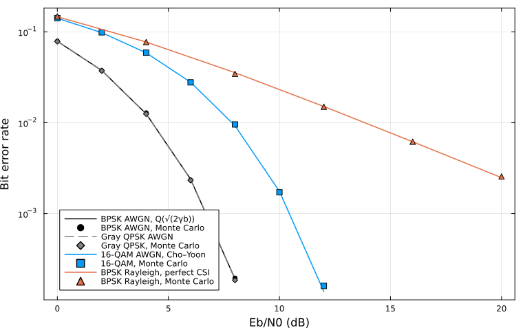

# CommToolkit.jl

> **v1.2.2**。公开接口按 SemVer 冻结。稳定面是 [公开接口](docs/src/api.md) 里 `using CommToolkit` 带入的名字；删除、改名或改变位置参数和已有返回值的含义，升主版本。1.x 相对 1.0.0 只做加法：1.1.0 新导出短 Reed–Solomon（`RSCode`、`rs_code`、`rs_shorten`、`rs_encode`、`rs_decode`），1.1.1 新增 `EXIT` 子模块（EXIT 图教学互信息测量），1.1.2 给 `simulate_link` 增加 `harq=:ir`（删余卷积行上的教学增量冗余），默认 `harq=:chase` 与 1.0.0 逐比特一致，1.1.3 给 `Channel` 增加教学簇延迟线（`CDLProfile`、`cdl_profile`、`CDLTaps`、`cdl_taps`、`apply_cdl`、`cdl_channel`，TR 38.901 CDL-A/B/C 延迟–功率剖面），1.2.0 新增 `XApp` 子模块（教学多用户 KPI→动作迷你 xApp：`XAppUE`、`UEKPI`、`XAppAction`、`FixedXAppPolicy`、`RuleXAppPolicy`、`xapp_actions`、`observe_kpi!`、`jain_index`、`XAppReport`、`simulate_xapp`），1.2.1 给 `Coding` 增加教学 Arikan 极化码（`PolarCode`、`polar_code`、`polar_encode`、`polar_sc_decode`，``N = 2^n \le 256`` 的 Bhattacharyya 构造、系统/非系统编码、SC 译码——教学 polar SC，非 NR polar），1.2.2 给 `sova_decode` 增加关键字 `return_coded`（默认 `false`；`true` 时另给编码比特外信息，教学 SOVA 的竞争路径度量差，非 MAP）；已有名字的位置参数、返回值与默认不变，`simulate_link` 未改。

基带通信链路仿真库，用来把蒙特卡洛误码率和教材中的闭式公式对上，并在 AWGN 上跑一条教学级的 MCS / HARQ 闭环。作者刘恒宇（longee142857）。

**稳定接口**：[docs/src/api.md](docs/src/api.md)。本包不是什么，见 [边界](docs/src/boundaries.md)。对照表见 [验证矩阵](docs/src/validation.md)。参数级限制见 [已知限制](docs/src/limitations.md)。

1.0.0 收的是已经落地的三块，不新加算法：0.9.1 的工程契约，0.9.2 的删余码率与 BICM 接入 MCS / Chase，0.9.3 的平坦 Kronecker。已有函数的位置参数和返回值不变。原来的五档表、默认 `receiver=:viterbi`，以及 0.9.2 的删余表都不变。

教学范围内的是带删余和 BICM 路径的 MCS / HARQ、平坦 Kronecker MIMO，以及 1.1.0 收进来的短 Reed–Solomon（``\mathrm{GF}(2^m)``、``m \le 4`` 的窄义本原码，长度 3、7、15 及其缩短，Berlekamp–Massey 硬判决）；1.1.1 加入 EXIT 图教学测量（直方图与蒙特卡洛软信息互信息、``J(\sigma)`` 近似、解映射与译码传递曲线）；1.1.2 给链路增加 `harq=:ir` 教学增量冗余（互补删余图案、按母码位软合并，默认 `:chase` 不变）；1.1.3 收进教学簇延迟线（TR 38.901 CDL-A/B/C 的归一化延迟与功率两列、式 (7.7-1) 延迟缩放、每抽头一个瑞利增益、可选逐抽头 Clarke 多普勒，静态 drop 可包成 `TDLChannel` 进 OFDM 链）；1.2.0 收进路线 C 的教学多用户 KPI→动作迷你 xApp（少量 UE 各自跑已有单链路闭环，共享每轮传输块预算与份额加权平均功率预算，规则表把累计 KPI 映射到 MCS 行 / 调度份额 / 功率偏移，与固定分配基线对照）。1.2.1 收进教学 Arikan 极化码（``N = 2^n \le 256``，Bhattacharyya 参数递归选信息集，系统/非系统编码，SC 译码；教学 polar SC，非 NR polar）。1.2.2 给已有 SOVA 增加可选的编码比特外信息（`sova_decode(...; return_coded=true)`，默认仍只返回信息比特外信息）。这是教学 SOVA，非 MAP：竞争路径度量差，不是 BCJR 边际，同点的误码或软互信息可以更差。有意留在范围之外的是完整几何 TR 38.901 CDL（角度、射线、天线几何、空间一致性、MIMO 全矩阵、LOS 的 CDL-D/E）、NR LDPC、NR polar（CRC 级联、CA-SCL 列表译码、速率匹配、NR 可靠度序列）、真 O-RAN（E2 接口、near-RT RIC、前传与功能切分）。不是 NR，不是 O-RAN，不是生产协议栈；教学 CDL 不声称 NR 合规，教学 xApp 不声称 O-RAN 合规，教学 SOVA 不声称 MAP。

## 功能

公开接口从子模块扁平再导出。例如 `modulate(bits, BPSK())`、`awgn(syms, snr_db, bits_per_symbol)`。没有重命名，因此没有弃用别名。`CommToolkit.modulation` 不在 `export` 列表里。

- **调制**（`Modulation`）：BPSK、Gray QPSK、Gray M-PSK、方形 Gray M-QAM，单位符号能量。硬判决，以及相干 AWGN 下的逐比特 LLR。DBPSK / DQPSK 在块首放参考符号，不是 ``\pi/4``-DQPSK。
- **信道**（`Channel`）：AWGN 的 `snr_db` 是 ``E_b/N_0``。平坦瑞利、块衰落、平坦 Rice（`K` 为线性比）、Clarke/Jakes 时间相关、Nakagami-m、理想 CSI 的 MRC，以及调用者给定抽头的单载波 FIR。1.1.3 增加教学簇延迟线：TR 38.901 CDL-A/B/C 的延迟–功率剖面、式 (7.7-1) 延迟缩放、每抽头一个瑞利增益、可选逐抽头 Clarke 多普勒；静态 drop 可包成 `TDLChannel` 进 OFDM 链。不是完整几何 38.901，不声称 NR 合规。
- **编码**（`Coding`）：终止的 (7, 5) 卷积码，硬 / 软 Viterbi、log-BCJR、教学 SOVA（`return_coded=true` 另给编码比特外信息，非 MAP），以及到 2/3、3/4 的周期删余。短帧 Turbo（记忆 2 的 RSC）。``\mathrm{GF}(2^m)``（``m = 2,3,4``）、Hamming(7,4)、二进制 BCH(15,7)。短 Reed–Solomon：``n \in \{3,7,15\}`` 的窄义本原码与缩短码，Berlekamp–Massey + Chien + Forney 硬判决。短 LDPC：Gallager、Fan 阵列码、系统编码、泛洪 sum-product 与 min-sum。教学 Arikan 极化码（1.2.1）：``N = 2^n \le 256``，Bhattacharyya 参数递归选信息集（Arikan 2009，Prop. 5），非系统与系统编码，串行抵消（SC）译码。教学 polar SC，非 NR polar：无 CRC 级联、无 CA-SCL、无速率匹配、无 NR 可靠度序列。
- **交织**（`Interleaving`）：矩形块交织，按行写入、按列读出。
- **BICM**（`BICM`）：比特交织编码调制的教学接收机。默认 Gray。`bicm_psk8_id_labels` 是 8-PSK 集合分割。卷积块可用 `rate = 2//3` 或 `3//4`，删余在交织之前。`simulate_link(...; receiver=:bicm)` 只调用卷积行。不是 NR BICM。
- **EXIT**（`EXIT`，1.1.1）：EXIT 图教学测量。`exit_mi_soft` 与 `exit_mi_hist` 测软信息互信息（Hagenauer 软估计、ten Brink 直方图），`exit_j` / `exit_jinv` 是写明的高斯对称近似，`exit_demap_transfer` 与 `exit_decoder_transfer` 在现有解映射器和 (7, 5) BCJR / 短 LDPC 上测传递曲线，`plot_exit_chart` 在 `using Plots` 后画图。1.2.2 的 SOVA 编码比特外信息是教学度量差，不进这条曲线。不是 NR LDPC 的 EXIT 生产工具。
- **链路**（`Link`）：CRC-16、原来的五档教学 MCS，以及另一张净荷 54 比特的删余卷积表。默认接收机是软输入 Viterbi。`receiver=:bicm` 在卷积行上改用 BICM。重传默认重复同一删余字（Chase）；`harq=:ir`（1.1.2）是删余卷积行上的教学增量冗余，偶数次重传发补图案、按母码位软合并。不是 NR 速率匹配。``E_s = 1``，``\sigma^2 = N_0/2``。
- **xApp**（`XApp`，1.2.0）：教学多用户 KPI→动作迷你闭环（路线 C），非 O-RAN。少量 UE 各自跑 `simulate_link` 单链路，共享每轮传输块预算与份额加权平均功率预算。KPI 是累计的 BLER 与已交付比特；动作是 MCS 行、调度份额、功率偏移。`FixedXAppPolicy` 是固定分配基线，`RuleXAppPolicy` 是规则表（比例公平风味份额、BLER 驱动功率档、门限选 MCS），`simulate_xapp` 报告每 UE 与系统的吞吐、BLER、频谱效率和 Jain 公平。没有 UE 间干扰模型，没有 E2 / RIC，不是 NR 调度器。
- **均衡**（`Equalization`）：线性块 ZF / MMSE、符号率 LMS、有限长块 DFE。
- **OFDM**（`OFDM`）：循环前缀收发、静态抽头延迟线、已知 CSI / LS / 逐导频收缩后线性插值、van de Beek 定时与小数倍频偏。
- **MIMO**（`MIMO`）：i.i.d. 瑞利上的 ML、ZF、MMSE、SIC，平坦 Kronecker 空间相关（`kronecker_channel`，Loyka 指数相关 `exponential_correlation`），ZF 与 SVD 预编码，总功率注水，Alamouti ``2\times1`` 与 ``2\times2``。不是 Weichselberger，也不是 TR 38.901 的 CDL / UMi。
- **扰码**（`Scrambling`）：加性 LFSR。`scramble` 与 `descramble` 从同一颗种子重起。
- **脉冲**（`Pulse`、`Visualization`）：升余弦与根升余弦，匹配滤波，按每符号样本数抽样。星座图、眼图和脉冲频谱在 `using Plots` 之后由 `CommToolkitPlotsExt` 提供。
- **同步**（`Sync`）：Gardner 定时、BPSK/QPSK 的 Costas 环、Schmidl–Cox 前导。不改 `ofdm_sync`。
- **指标**（`Metrics`）：误码率、符号错误率、帧错误率、RMS EVM，以及 dB 与线性信噪比换算。

## 安装

需要 Julia 1.10 或更新版本。

```julia
using Pkg
Pkg.add(url="https://github.com/longee142857/CommToolkit.jl")
using CommToolkit
```

`using CommToolkit` 不加载 Plots。作图时再执行 `using Plots`。

```julia
bits = rand(0:1, 10_000)
rx = awgn(modulate(bits, BPSK()), 8, 1)  # 8 dB Eb/N0
ber(bits, demodulate(rx, BPSK()))
```

## 验证

固定种子 `0x0c0de1162` 的蒙特卡洛点与闭式曲线。实线是理论值，标记是仿真。生成脚本是 `demos/validation_figure.jl`。统计检验在 `test/`：双侧 Clopper–Pearson 区间（``\alpha = 10^{-4}``，并要求足够的错误计数），理论值必须落在区间内。

公式、出处、测试文件和演示的对应关系在 [验证矩阵](docs/src/validation.md)。实现在 `test/reference.jl`。下面这张图仍是 v0.6 之前的四条曲线；Gray M-PSK、差分 PSK、Rice、MRC、Jakes 和 Nakagami-m 的对照在同一页。



删余 MCS 和链路内 BICM 的对照写在 [验证矩阵](docs/src/validation.md)。打印表在 `demos/link_puncture_bicm.jl`，不依赖 Plots。种子仍是 `0x0c0de1162`，每点 80 块，区间仍是 Clopper–Pearson（``\alpha = 10^{-4}``）。3 dB 和 10 dB 比较自适应与固定行，2 dB 的 QPSK 3/4 比较 3 次 Chase 与单次，6 dB 的 8-PSK 比较 1 次与 4 次迭代。5 dB 附近码率 2/3 和 3/4 几乎打平，测试不拿它做判据。

本地运行：

```julia
using Pkg
Pkg.test("CommToolkit")
```

## 源码布局

```
src/CommToolkit.jl    模块入口与再导出
src/modulation.jl     Modulation
src/channel.jl        Channel（含 Rice、Clarke/Jakes、Nakagami-m、理想 CSI MRC、单载波 FIR；包含 cdl.jl）
src/cdl.jl            教学簇延迟线：TR 38.901 CDL-A/B/C 剖面、延迟缩放与样本量化、逐抽头 Jakes（1.1.3）
src/pulse.jl          Pulse：匹配滤波与按 sps 抽样
src/coding.jl         Coding（包含 ldpc.jl、turbo.jl、algebraic.jl、polar.jl；卷积与 SOVA 在本文件）
src/turbo.jl          短帧 Turbo：记忆 2 RSC、块/步长交织、log-BCJR 迭代
src/algebraic.jl      GF(2^m)、Hamming(7,4) 伴随式硬判决、BCH(15,7)、短 Reed–Solomon
src/interleaving.jl   Interleaving：矩形块交织
src/bicm.jl           BICM：比特交织编码调制、卷积删余与迭代解调
src/exit.jl           EXIT：软信息互信息测量、J(σ) 近似、传递曲线（1.1.1）
src/ldpc.jl           短 LDPC：Gallager、阵列码、系统编码、泛洪译码
src/polar.jl          教学 Arikan 极化码：Bhattacharyya 构造、系统/非系统编码、SC 译码（1.2.1，非 NR polar）
src/link.jl           Link：CRC-16、教学 MCS、删余码率、Chase 合并与教学增量冗余（`harq=:ir`）、BICM 接收机
src/xapp.jl           XApp：教学多用户 KPI→动作迷你 xApp（1.2.0，路线 C，非 O-RAN）
src/equalization.jl   Equalization
src/ofdm.jl           OFDM
src/mimo.jl           MIMO（含平坦 Kronecker 与 Loyka 指数相关）
src/scrambling.jl     Scrambling：加性 LFSR
src/visualization.jl  Visualization（作图函数在未加载 Plots 时抛错）
src/sync.jl           Sync：Gardner、Costas、Schmidl–Cox
src/metrics.jl        Metrics
ext/CommToolkitPlotsExt.jl
test/                 闭式对照与单元测试
docs/                 公开接口、验证矩阵、边界、已知限制，以及 Documenter API 参考
demos/                可单独运行的脚本，不在测试范围内
fpga/ax7020/          AX7020（Zynq-7020）教学 PL：BPSK + AWGN + BER。概念对照，不是数值契约。见该目录 README。
```

API 参考由 Documenter 从导出函数的 docstring 生成，页面只含接口说明。

## 许可

MIT。Copyright (c) 2026 刘恒宇 (longee142857)。见 `LICENSE`。

## 已知限制

完整条目在 [docs/src/limitations.md](docs/src/limitations.md)。1.0.0 不放宽这些限制；1.1.0 只增加短 Reed–Solomon，1.1.1 只增加 EXIT 测量，1.1.3 只增加教学簇延迟线，1.2.0 只增加教学迷你 xApp，1.2.1 只增加教学极化码，1.2.2 只给 `sova_decode` 增加 `return_coded`（教学 SOVA，非 MAP），都不放宽。0.9.2 改的是删余 MCS、卷积 BICM 接收机和同一删余字的 Chase。0.9.3 增加平坦 Kronecker。1.1.2 放宽一条：`harq=:ir` 教学增量冗余。这里只留检索用的几条：

- 卷积母码仍是 (7, 5)。删余只有 2/3 和 3/4 两张图案。教学 MCS 可以用这三档名义码率，母码长度必须是图案周期的整数倍。联合界不覆盖删余码。不是 NR 速率匹配。SOVA（1.2.2 起可用 `return_coded=true` 取编码比特外信息）是教学竞争路径度量差，不是 MAP，同点可以差于 BCJR；平局与 ``\sum|L|`` 截断写在 `sova_decode` 的文档字符串里。BICM 与 EXIT 曲线都不消费这条外信息。
- Turbo 是记忆 2 的短帧，不是 3GPP。BCH 只有 (15, 7)。Reed–Solomon 是 ``m \le 4`` 的短窄义本原码及其缩短，不是 CCSDS 长码，也不是软代数译码。
- LDPC 是短教学码，不是 NR 基图。`receiver=:bicm` 只接卷积行，不是 NR BICM。EXIT 是教学互信息测量：软估计假定一致 LLR，直方图有分箱偏差，``J(\sigma)`` 是高斯对称近似；不是 NR LDPC 的 EXIT 生产工具。
- 极化码（1.2.1）是教学 Arikan polar SC：``N = 2^n \le 256``，信息集是 Bhattacharyya 递归（AWGN 上是启发式，不是 NR 可靠度序列），SC 是 ``O(N \log N)`` 的逐位序贯判决，不是最大似然，有错误传播。无 CRC 级联、无 CA-SCL 列表译码、无速率匹配、无 PW/QPP 交织——NR polar 仍在范围外。
- Jakes 是平坦 Clarke 谱的 DFT 实现，不是正弦和，也不是抽头延迟线。`TDLChannel` 本身仍不是 TR 38.901 的 CDL；1.1.3 的教学 CDL（`cdl_profile` / `cdl_taps` / `cdl_channel`）只有 CDL-A/B/C 的延迟–功率两列加每抽头瑞利、可选逐抽头 Jakes 多普勒，没有角度、射线、天线几何与空间相关，不声称 NR 合规。
- Kronecker 是一次平坦矩阵 ``R_r^{1/2} H_w R_t^{1/2}``。`mimo_channel` 仍是 i.i.d.。指数相关是 Loyka 的 Toeplitz 矩阵，不是 ``J_0``。检测器不按 ``R_t``、``R_r`` 做预白化。不是 Weichselberger，也不是 UMi。
- OFDM 的 “MMSE” 是导频收缩后的线性插值。`ofdm_sync` 只在 ``(-1/2, 1/2)`` 个子载波间隔内无模糊。
- Gardner、Costas、Schmidl–Cox 有写明的捕获范围，不是生产级接收机，也不是调度器。
- 链路闭环是单链路 AWGN。原来的五档表还在；删余表是另一张，门限不能混用。Chase（默认）重复同一删余字；`harq=:ir` 是互补删余图案的教学增量冗余：静态 AWGN 上 `max_tx=2` 时 BLER 高于 Chase，`max_tx=3` 时与 Chase 分不开但信道使用更少。不是 NR 速率匹配，也不是 RV0–RV3。`Link` 自己没有多用户调度；1.2.0 的 `XApp` 在它之上做教学多用户 KPI→动作闭环（路线 C 的迷你 xApp），KPI 累计无滑动窗、无 UE 间干扰模型，非 O-RAN，也不是 NR 调度器。完整几何 CDL、NR LDPC、真 O-RAN 仍在范围外。
