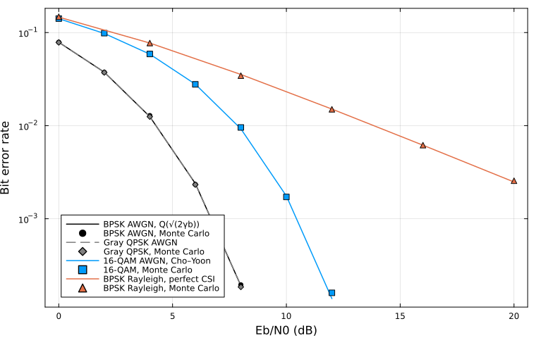

**中文** | [English](README.en.md)

# CommToolkit.jl

基带通信链路仿真库，当前 **v1.5.0**（[`Project.toml`](Project.toml)）。把蒙特卡洛误码率和教材中的闭式公式对上，并在 AWGN 上跑一条教学级的 MCS / HARQ 闭环。作者刘恒宇（longee142857）。

`using CommToolkit` 带入的名字是稳定面，按 SemVer 冻结：删除、改名或改变位置参数和已有返回值的含义，升主版本。1.x 相对 1.0.0 只做加法。各版细节见 [变更记录](CHANGELOG.md)。

## 安装

需要 Julia 1.10 或更新版本。`using CommToolkit` 不加载 Plots；作图时再执行 `using Plots`。

```julia
using Pkg
Pkg.add(url="https://github.com/longee142857/CommToolkit.jl")
using CommToolkit
```

## 快速开始

```julia
bits = rand(0:1, 10_000)
rx = awgn(modulate(bits, BPSK()), 8, 1)  # 8 dB Eb/N0
ber(bits, demodulate(rx, BPSK()))
```

`8` 是这次 BPSK 调用的 ``E_b/N_0``（dB）。`simulate_link` 的参数是 ``E_s/N_0``，`apply_channel` 是时域样本 SNR。软解调的 `noise_var` 是每实维 ``\sigma^2 = N_0/2``；复 `fir_channel` 的返回值和 `apply_mimo` 的 `noise_var` 是复噪声总功率 ``N_0``。各函数的文档写自己的定义。

## 功能

公开接口从子模块扁平再导出，例如 `modulate(bits, BPSK())`。没有弃用别名。

- **调制**：BPSK、Gray QPSK / M-PSK / 方形 M-QAM；硬判决与相干 AWGN 逐比特 LLR。DBPSK / DQPSK 在块首放参考符号。
- **信道**：AWGN（`snr_db` 为 ``E_b/N_0``）、平坦瑞利与块衰落、Rice、Clarke/Jakes、Nakagami-m、理想 CSI 的 MRC、给定抽头的 FIR，以及教学 CDL-A/B/C 延迟线。不是完整几何 TR 38.901。
- **编码**：终止的 (7, 5) 卷积码（硬 / 软 Viterbi、log-BCJR、教学 SOVA）与周期删余、短帧 Turbo、``\mathrm{GF}(2^m)``、Hamming(7,4)、BCH(15,7)、短 Reed–Solomon、短 LDPC、教学 Arikan 极化码（SC）。不是 NR LDPC，也不是 NR polar。
- **交织**：矩形块交织，按行写入、按列读出。
- **BICM**：教学比特交织编码调制，默认 Gray。`simulate_link(...; receiver=:bicm)` 只接卷积行。
- **EXIT**：软信息互信息、``J(\sigma)`` 近似，以及解映射与译码传递曲线。
- **链路**：CRC-16 与教学 MCS，默认软输入 Viterbi。重传默认 Chase，`harq=:ir` 为删余卷积行上的教学增量冗余。
- **xApp**：少量 UE 各自跑已有单链路，把累计 KPI 映射到 MCS、调度份额与功率偏移。不是 O-RAN。
- **均衡**：线性块 ZF / MMSE、符号率 LMS、有限长块 DFE。
- **OFDM**：循环前缀收发、静态抽头延迟线、已知 CSI / LS / 插值、van de Beek 定时与小数倍频偏。
- **MIMO**：i.i.d. 瑞利上的 ML、ZF、MMSE、SIC，平坦 Kronecker 相关，ZF 与 SVD 预编码，注水，Alamouti。
- **扰码**：加性 LFSR。`scramble` 与 `descramble` 从同一颗种子重起。
- **脉冲**：升余弦与根升余弦，匹配滤波与按每符号样本数抽样。星座、眼图和频谱在 `using Plots` 之后提供。
- **同步**：Gardner 定时、BPSK/QPSK 的 Costas 环、Schmidl–Cox 前导。
- **指标**：误码率、符号错误率、帧错误率、RMS EVM，以及 dB 与线性信噪比换算。

## 文档

- [公开接口](docs/src/api.md)
- [边界](docs/src/boundaries.md)
- [验证矩阵](docs/src/validation.md)
- [已知限制](docs/src/limitations.md)
- [变更记录](CHANGELOG.md)

源码在 `src/`，可单独运行的脚本在 `demos/`。AX7020 教学对照见 [`fpga/ax7020/README.md`](fpga/ax7020/README.md)，不是数值契约。

## 验证

固定种子 `0x0c0de1162`。实线是理论值，标记是仿真；生成脚本是 `demos/validation_figure.jl`。`test/` 用双侧 Clopper–Pearson 区间（``\alpha = 10^{-4}``）。公式、出处和测试对应关系见 [验证矩阵](docs/src/validation.md)。下图仍是 v0.6 之前的四条曲线，其余对照在同一页。

不画图的未编码对照是 [`demos/lab_awgn_ber.jl`](demos/lab_awgn_ber.jl)：局部随机数，在 0/2/4 dB 打印 BPSK/QPSK 的样本数、错误数、BER、理论值和逐点 Wilson 区间（每个点 ``\alpha = 10^{-3}``，不是六个点合在一起）。这几个工作点还要求错误数至少 30，这条要求不推广到 8 dB。错误数为 0 时上界不是无误码证明。脚本里 BPSK 与 QPSK 共用一条 ``Q(\sqrt{2\gamma})``，不是全仓唯一实现。`(7, 5)` 终止码把 `n` 个信息比特编成 `2(n+2)` 个编码比特，有效码率不是 `1/2`；这条脚本不含编码。

不画图的根升余弦对照是 [`demos/lab_rrc_isi.jl`](demos/lab_rrc_isi.jl)。局部随机数，实 BPSK。发端全卷积、匹配滤波、按已知下标抽样。升余弦只作参照。残余是截断的测量。眼图下界是 ``2(g_0-S)``，允许为负。错一个样本只说明抽样相位不同，不是同步。`pulse_shape` 的截尾仍是眼图辅助接口，这条脚本不用它。



```julia
using Pkg
Pkg.test("CommToolkit")
```

## 许可

MIT。Copyright (c) 2026 刘恒宇 (longee142857)。见 [`LICENSE`](LICENSE)。
